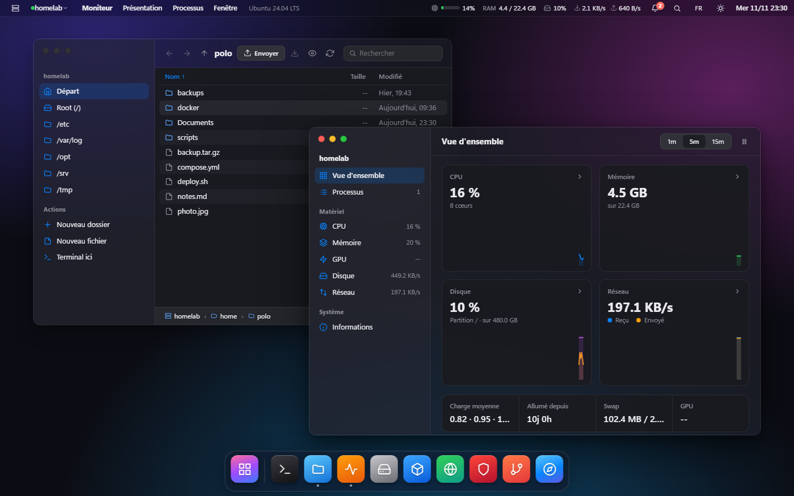
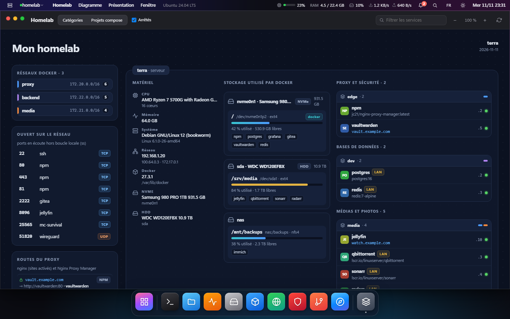
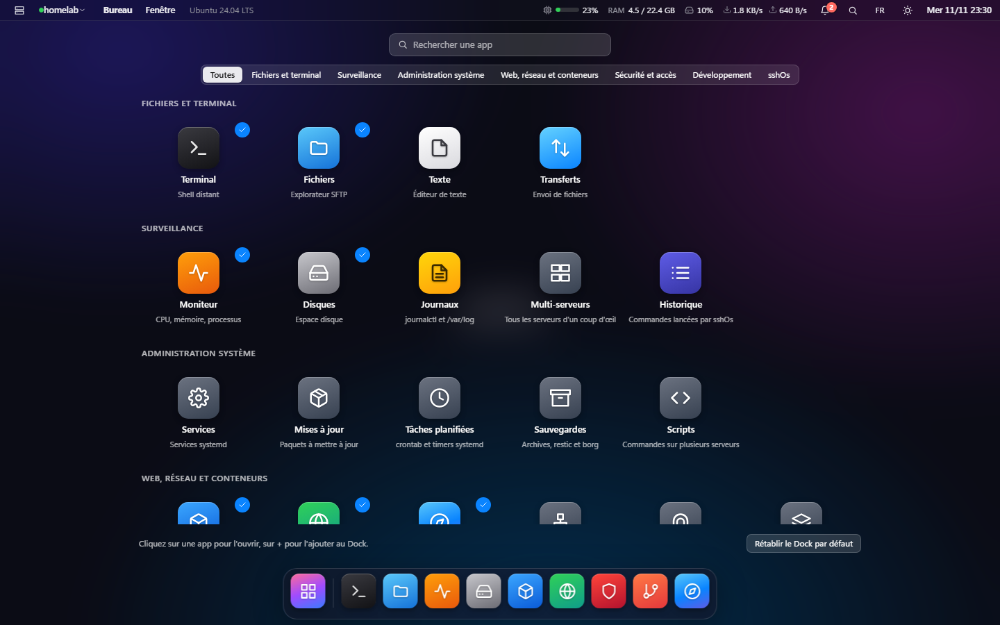
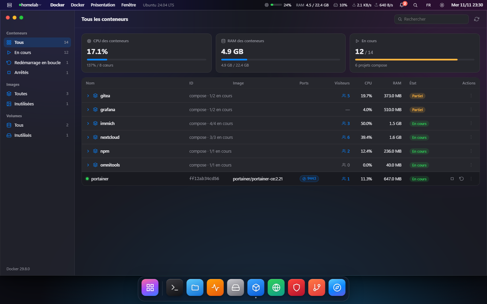
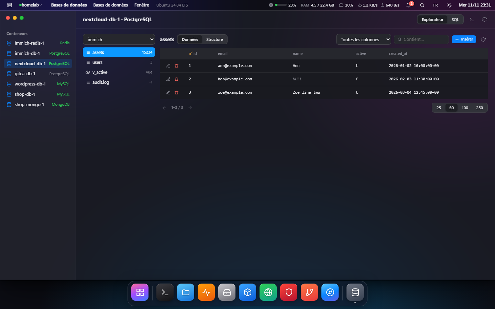
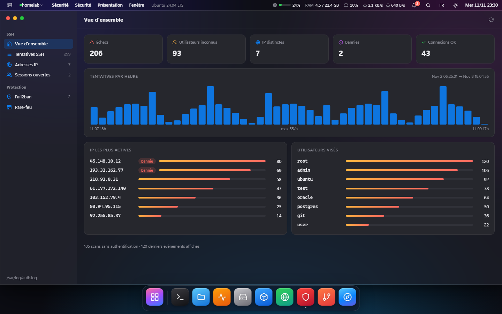

# sshOs

*[English](README.md) · Français*

Bureau de gestion de serveurs **sans agent** : tout passe par SSH/SFTP. Application desktop
Rust — backend [Tauri v2](https://tauri.app) + [russh](https://github.com/Eugeny/russh), interface
[Leptos](https://leptos.dev) compilée en WebAssembly.

> sshOs est un portage en Rust de **[Davish](https://github.com/2hjaito/davish)** (Go + Wails + Svelte),
> dont il reprend le concept et les règles de sécurité. Merci à ses auteurs. sshOs est un projet
> indépendant et n'utilise ni le nom ni le logo de Davish.



**Homelab** : le serveur dessiné comme un schéma, avec le matériel, les disques, les réseaux Docker, les ports ouverts, les routes du proxy et les services par catégorie.



| Lanceur d'applications (F4) | Docker, avec les visiteurs actuels par service |
|---|---|
|  |  |

| Explorateur de bases de données (PostgreSQL, MySQL, MongoDB, Redis) | Sécurité |
|---|---|
|  |  |

<sub>Captures prises avec des données fictives (aucun vrai serveur).</sub>

## Applications (MVP)

| App | Ce qu'elle fait |
|---|---|
| **Connexions** | Hôtes SSH (mot de passe, clé, agent ou clés `~/.ssh/id_*` par défaut), saut ProxyJump, import `~/.ssh/config`, secrets dans le trousseau de l'OS, vérification des empreintes (TOFU) |
| **Terminal** | PTY distant dans xterm.js |
| **Fichiers** | Navigateur SFTP façon Finder (favoris, précédent/suivant, tri par nom/taille/date, fil d'Ariane, menu contextuel), envoi/téléchargement (y compris glisser-déposer), opérations avec la commande affichée avant exécution |
| **Éditeur** | CodeMirror 6, écriture atomique, sauvegarde `.bak` sous `/etc` |
| **Moniteur** | Façon Moniteur d'activité : onglets CPU / Mémoire / Disque / Réseau / GPU, graphes d'historique, CPU par cœur, pression mémoire, débits disque et réseau, processus triables (TERM/KILL) |
| **Disques** | Partitions (`df`), analyse de l'espace par dossier (`du`, double-clic pour descendre), nettoyage guidé (journaux, archives de logs, cache APT, Docker) avec la commande affichée avant |
| **Texte** | Ouvre n'importe quel fichier texte du serveur (aussi par double-clic dans Fichiers) |
| **Transferts** | Envoi de fichiers vers un dossier du serveur, file des transferts en cours ; **glisser-déposer depuis l'Explorateur Windows** sur une fenêtre Fichiers, et bouton **Envoyer** dans Fichiers |
| **Journaux** | `journalctl` par service et fichiers de `/var/log`, filtre, suivi en direct, lecture `sudo` via Terminal |
| **Git** | Dépôts trouvés sur le serveur (`~`, `/var/www`, `/srv`, `/opt`) : statut, historique, branches, diff, pull/fetch avec commande affichée |
| **Historique des commandes** | Toutes les commandes lancées par sshOs sur chaque serveur (hors sondages périodiques), avec code de retour et durée ; relancer dans un Terminal |
| **Nginx** | Sites nginx natifs **et** Nginx Proxy Manager dans une seule liste |
| **Docker** | Conteneurs groupés par projet compose, CPU/RAM en direct, **visiteurs actuels des services web** (adresses IP distinctes connectées au conteneur, lues dans `/proc` sans sudo, plus celles vues ces 5 dernières minutes dans les logs de Nginx Proxy Manager pour les sites qui pointent vers lui), logs, **shell intégré** (panneau en bas de l'app, un onglet par conteneur), inspect, start/stop/restart, ouverture dans le Navigateur, images et volumes (inutilisés compris) |
| **Navigateur** | Pages web **du serveur** à travers un tunnel SSH : `localhost:3000`, `9443` ou l'IP d'un conteneur. Puces des ports en écoute (`ss -ltn`), **Ping** (`curl` exécuté sur le serveur : code HTTP et temps), historique, ouverture dans une fenêtre séparée pour les sites qui refusent l'affichage intégré |
| **Sécurité** | Tentatives de connexion SSH (échecs, utilisateurs inconnus, scans), IP les plus actives, graphique horaire, sessions ouvertes, **fail2ban** (jails, IP bannies, ban/déban) et **éditeur visuel** des jails (maxretry, findtime, bantime, port, ignoreip), **pare-feu** (onglet Pare-feu : règles ufw, ouvrir/bloquer un port avec aperçu de la commande, ports en écoute croisés avec les règles ; garde-fou qui autorise le port SSH avant d'activer ufw ; repli en lecture sur nftables) |
| **Services** | Services systemd (en cours, en échec, arrêtés, lancés au démarrage) : start/stop/restart, activer au démarrage, statut et journal |
| **Mises à jour** | Paquets à mettre à jour (apt, dnf, yum), mises à jour de sécurité mises en avant, redémarrage requis ; mise à jour lancée dans un Terminal |
| **Certificats** | Certificats TLS (Let's Encrypt, nginx, domaines ajoutés à la main) avec date d'expiration ; **notification** quand un certificat expire dans 15 jours ou moins ; test et renouvellement `certbot` dans un Terminal |
| **Tâches planifiées** | crontab utilisateur (éditeur avec raccourcis de planification et description lisible), `/etc/crontab`, `/etc/cron.d` et timers systemd |
| **Utilisateurs et clés** | Comptes, groupes et administrateurs (groupe sudo / wheel), `authorized_keys` (ajout/retrait, empreintes), dernières connexions |
| **Réseau** | Interfaces et adresses, routes, DNS, ports en écoute (ouvrir dans le Navigateur ou créer un tunnel), connexions actives, outils (ping, traceroute, dig, curl) |
| **Tunnels** | Redirections de ports SSH locales (`127.0.0.1:port` → `hôte:port` vu du serveur), suggestions depuis les ports en écoute, fermeture |
| **Sauvegardes** | Archive `tar.gz` d'un dossier (téléchargeable), dépôts **restic** / **borg** (init, sauvegarde, liste, vérification) dans un Terminal, la phrase de passe n'est jamais vue par sshOs |
| **Bases de données** | Conteneurs PostgreSQL, MySQL/MariaDB, Redis, MongoDB détectés via Docker (image, ou variables d'environnement et ports exposés pour les images perso) : connexion MySQL/MariaDB avec les identifiants de la config Docker (`MYSQL_*` / `MARIADB_*`, secrets `*_PASSWORD_FILE`, utilisateur applicatif si le mot de passe root est aléatoire), le mot de passe n'est jamais affiché ni stocké ; **explorateur façon phpMyAdmin pour MySQL/MariaDB et PostgreSQL** (bases, schémas, tables, données paginées avec tri et recherche, structure, modification / insertion / suppression de lignes, chaque écriture confirmée avec la commande exacte) et **pour MongoDB** (bases, collections, documents paginés avec filtre texte ou `{ champ: valeur }`, tri, index, édition / insertion / suppression de documents en JSON étendu via `mongosh`) ; connexion PostgreSQL / MongoDB avec `POSTGRES_USER` / `MONGO_INITDB_ROOT_*` lus dans le conteneur ; requêtes rapides en lecture, requête libre confirmée avec la commande affichée, shell client dans un Terminal |
| **Multi-serveurs** | Une carte par serveur : charge, mémoire, disque, uptime, services en échec, mises à jour en attente, redémarrage requis ; connexion de tous les serveurs |
| **Homelab** | Schéma interactif du serveur, façon carte de homelab : matériel, disques et systèmes de fichiers utilisés par Docker, réseaux Docker, ports ouverts, routes nginx / Nginx Proxy Manager et services rangés en colonnes par catégorie ou par projet compose (une carte « stack » par projet). Le survol d'un élément allume ses liens et ses câbles ; clic sur un conteneur pour ses détails. Déplacement au clic-glissé, zoom, filtre. Lecture seule |
| **Scripts** | Bibliothèque de commandes réutilisables, exécutées sur un ou plusieurs serveurs avec la sortie de chacun ; les scripts `sudo` s'ouvrent dans un Terminal par serveur |

La barre de menu affiche une cloche de **notifications** (services systemd en échec sur chaque serveur connecté, avec accès aux logs et redémarrage ; certificats TLS qui expirent dans 15 jours ou moins) et, en continu, le CPU, la RAM, le disque `/` et le débit réseau du serveur actif.
### Bureau

- L'app s'ouvre **en fenêtre maximisée** (plein écran fenêtré) : barre de titre, barre des tâches Windows et Dock natif (macOS/Linux) restent accessibles. **F11** (ou Réglages → plein écran) passe en vrai plein écran.
- **Lanceur d'applications** (icône à gauche du Dock, **F4**, menu sshOs → Applications…) : toutes les apps rangées par catégorie (Fichiers et terminal, Surveillance, Web et conteneurs, Sécurité et accès, Développement, sshOs), avec une recherche. Le bouton **+** d'une app l'ajoute au Dock, ✓ l'en retire ; « Rétablir le Dock par défaut » remet la liste d'origine.
- **Dock** par défaut : Terminal, Fichiers, Moniteur, Disques, Docker, Nginx, Sécurité, Git, Navigateur. Les apps ouvertes qui n'y sont pas apparaissent après un séparateur.
- **Langues** : français, anglais, allemand, espagnol. Par défaut, la langue du système ; modifiable dans l'assistant de bienvenue, le menu de la barre du haut ou les Réglages.
- **Visite guidée** au premier lancement (menu sshOs → Visite guidée…) : chaque zone (serveur, menus, ressources, notifications, Spotlight, langue, Dock) est mise en avant avec un texte descriptif. ← → / Entrée / Échap.
- Fenêtres en **verre dépoli** ; la fenêtre au premier plan est un peu plus opaque, et les zones denses (tableaux, terminal, éditeur) restent lisibles.
- La barre du haut affiche les **menus de l'app au premier plan**, comme sur macOS (Fichiers : Fichier / Présentation / Aller ; Docker : Docker / Présentation ; Navigateur : Navigation…), plus les menus **sshOs** et **Fenêtre**.
- **Clic droit sur une icône du Dock** : fenêtres ouvertes de l'app, Nouvelle fenêtre, Garder dans le Dock / Retirer du Dock, Afficher toutes les fenêtres, Masquer, Quitter.
- En cas d'erreur interne de l'interface, un bandeau propose de la recharger ; les connexions SSH, gérées par le backend, sont conservées.

Toute action qui demande `sudo` (fail2ban, `docker` hors groupe docker…) s'ouvre dans un Terminal avec la commande pré-tapée.

### Nginx + Nginx Proxy Manager

- **nginx natif** : liste des sites (`sites-available` ou `conf.d`), activer/désactiver, édition,
  modification rapide (domaines, `proxy_pass`, `client_max_body_size`), nouveau site (reverse proxy,
  statique, PHP-FPM) avec aperçu, HTTPS via `certbot` dans un terminal.
  `nginx -t` est **toujours** lancé avant le rechargement ; la sauvegarde est restaurée en cas d'échec.
- **Nginx Proxy Manager** : détecté via `docker ps` (image `jc21/nginx-proxy-manager`) ou configuré
  à la main dans la connexion (« API Nginx Proxy Manager »). sshOs parle à son **API REST à travers un tunnel SSH**
  (`direct-tcpip`) : proxy hosts, redirections, streams, certificats Let's Encrypt, listes d'accès.
  Les modifications passent **uniquement** par l'API (NPM régénère et recharge nginx lui-même) ;
  la conf générée est consultable en lecture seule. Les identifiants NPM peuvent être mémorisés
  dans le trousseau.

### Sécurité

- Jamais de `sudo` silencieux : une action qui exige root ouvre un Terminal avec la commande
  pré-tapée, et c'est vous qui appuyez sur Entrée.
- Chaque opération sur le serveur affiche la commande exacte avant exécution.
- L'éditeur fail2ban écrit `/etc/fail2ban/jail.d/zz-sshos.local`, puis lance `fail2ban-client -t`
  avant le rechargement ; si la vérification échoue, l'ancien fichier est restauré.

## Développement

Prérequis : Rust stable, cible `wasm32-unknown-unknown`, [`trunk`](https://trunkrs.dev), Node.js,
WebView2 (Windows).

```bash
rustup target add wasm32-unknown-unknown
cargo install trunk
npm install
npm run dev        # = tauri dev (bundle JS + trunk serve + app)
npm run build      # binaire + installeurs
cargo test -p sshos-shared -p sshos
```

Sous Linux, il faut aussi les bibliothèques de Tauri : `libwebkit2gtk-4.1-dev libappindicator3-dev librsvg2-dev patchelf libssl-dev libdbus-1-dev`.

### Builds

Le workflow [`.github/workflows/build.yml`](.github/workflows/build.yml) lance les tests puis construit les installeurs
**Windows** (`.msi`, `.exe` NSIS) et **Linux** (`.deb`, `.rpm`, `.AppImage`) uniquement quand un tag de version
`vX.Y` ou `vX.Y.Z` est poussé, puis publie une release GitHub avec ces fichiers :

```bash
git tag v0.2.0 && git push origin v0.2.0
```

Avant, mettez la même version dans `Cargo.toml` et `src-tauri/tauri.conf.json`, et ajoutez sa section `## [X.Y.Z] - date` dans `CHANGELOG.md` et `CHANGELOG.fr.md` : le texte de la release en est extrait. Le workflow peut aussi être lancé à la
main depuis l'onglet Actions (installeurs en artefacts, sans release).

Serveur de test (nginx natif + Nginx Proxy Manager) : voir [`test/docker-compose.yml`](test/docker-compose.yml).

## Structure

```
shared/      types sérialisables partagés backend ↔ interface
src-tauri/   backend : ssh (pool, auth, known_hosts, tunnels), terminal, sftp, monitor, nginx/{files,npm}
frontend/    interface Leptos : wm.rs (bureau, fenêtres, dock, spotlight), apps/*, js/vendor.js (xterm + CodeMirror)
```

## Journal des modifications

Voir [CHANGELOG.fr.md](CHANGELOG.fr.md). Chaque release GitHub reprend la section de sa version, en anglais et en français.

## Licence

[GPL-3.0-or-later](LICENSE)

## Démarrage et serveurs
- Le dernier serveur actif est reconnecté automatiquement au lancement (une déconnexion volontaire l'oublie).
- Le sélecteur de serveur est dans la barre du haut, juste après l'icône sshOs ; « Gérer les connexions… » y ouvre l'app Connexions, qui ne figure plus dans le Dock.
- Une présentation (onboarding) s'affiche au premier lancement ; elle reste accessible depuis le menu sshOs.
- Nginx : si le serveur a à la fois nginx (service) et Nginx Proxy Manager (Docker), sshOs demande lequel gérer. Le choix est mémorisé par serveur et modifiable dans le menu Source.
- Docker : chaque port publié d'un conteneur en cours d'exécution est un bouton qui l'ouvre dans le Navigateur intégré.

## Réglages
App **Réglages** (Dock, menu sshOs ou Ctrl+,). Tout est enregistré localement (`localStorage`, clé `sshos.settings`) :
- **Général** : langue, plein écran, présentation, raccourcis clavier.
- **Apparence** : thème clair / sombre / automatique (suit Windows), couleur d'accentuation, fond d'écran, transparence (forte, normale, aucune), réduction des animations.
- **Bureau et Dock** : taille du Dock, agrandissement au survol, utilisation du serveur dans la barre de menus, secondes dans l'horloge.
- **Sécurité** :
  - reconnexion automatique au lancement ;
  - déconnexion de tous les serveurs après 5, 15, 30 ou 60 min d'inactivité ;
  - confirmation avant de quitter, y compris avec Alt+F4 ;
  - floutage des adresses `user@hôte` (partage d'écran).
- **Toujours actif** : ces règles sont affichées en lecture seule et ne sont pas désactivables.
  - pas de sudo silencieux ;
  - commande affichée avant exécution ;
  - `nginx -t` / `fail2ban-client -t` avant rechargement ;
  - NPM uniquement via son API ;
  - vérification des empreintes d'hôte ;
  - secrets dans le trousseau du système.
- **Données locales** : oublier le dernier serveur, réinitialiser les choix Nginx ou les réglages, tout effacer. Cela ne touche ni les serveurs enregistrés ni leurs secrets.
