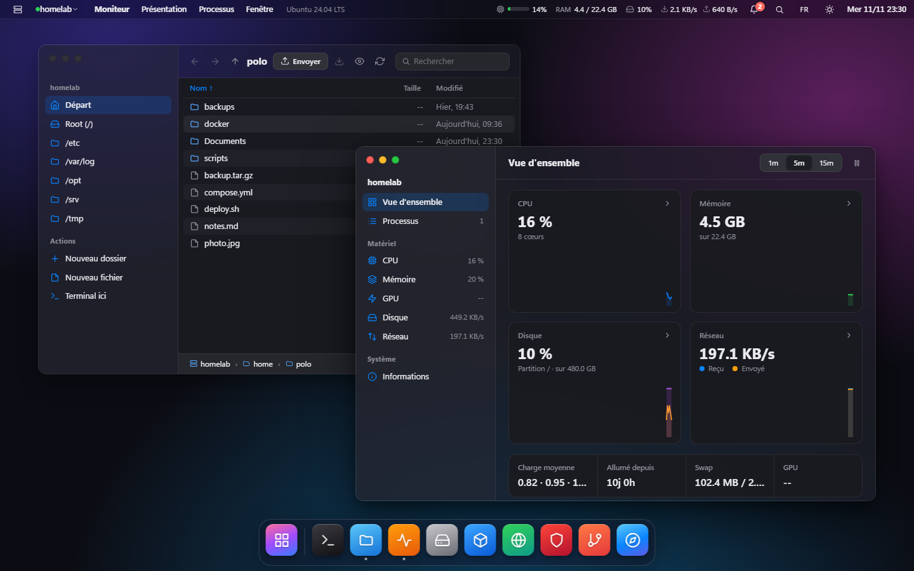
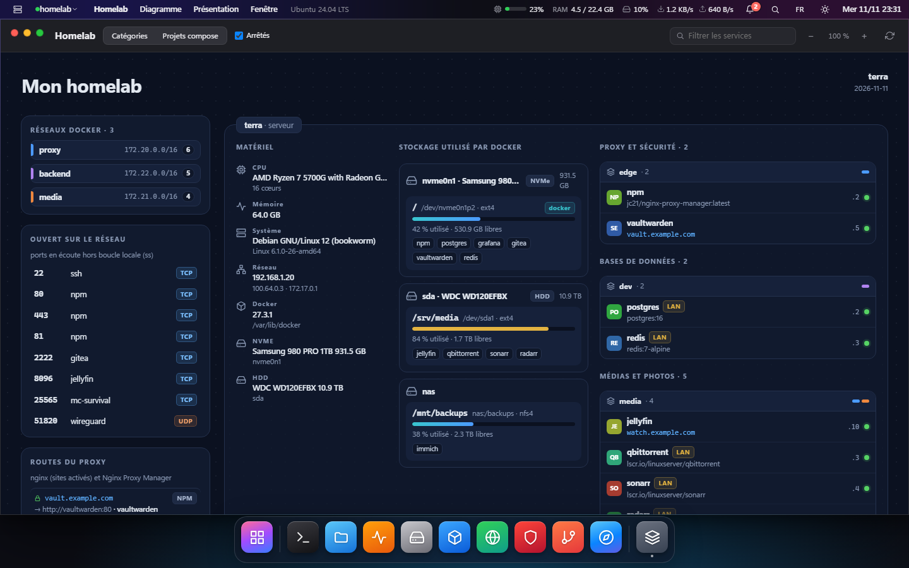
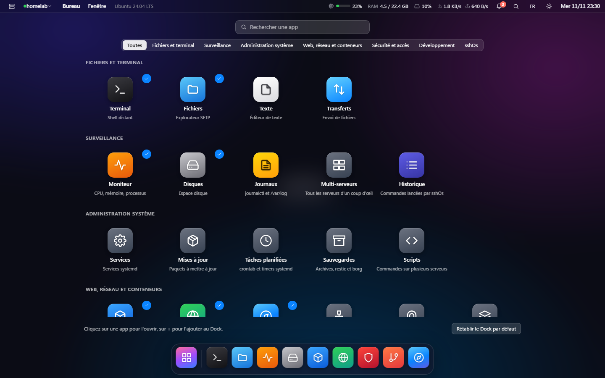
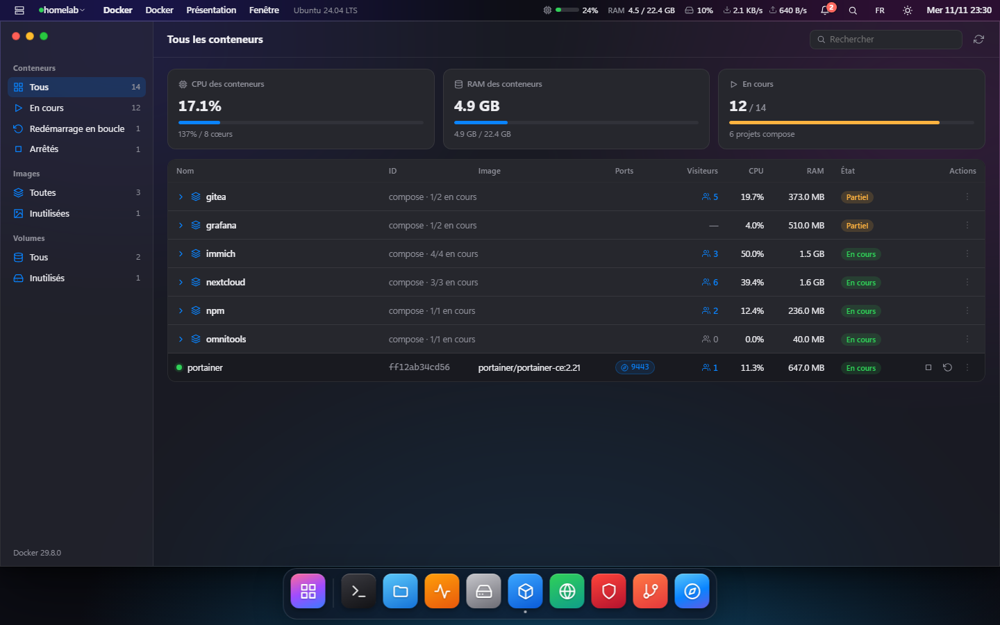
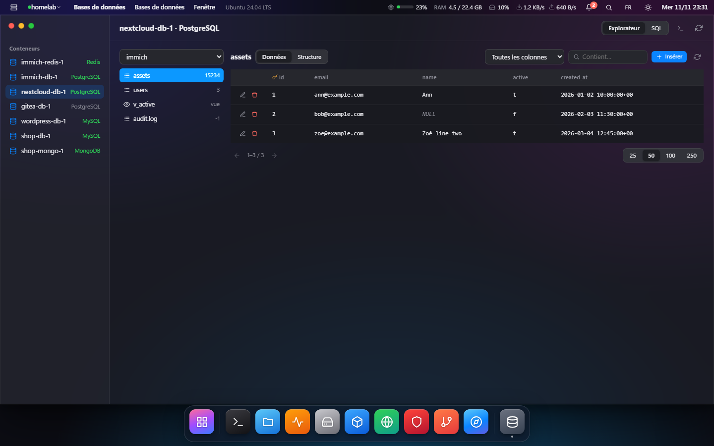
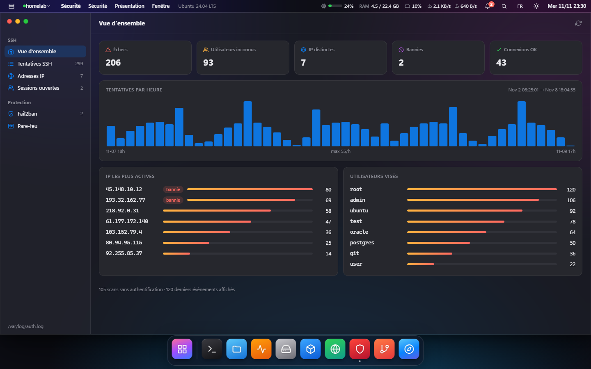

# sshOs

*English · [Français](README.fr.md)*

An **agentless** server management desktop: everything goes through SSH/SFTP. A Rust desktop
app — [Tauri v2](https://tauri.app) + [russh](https://github.com/Eugeny/russh) backend, UI written in
[Leptos](https://leptos.dev) and compiled to WebAssembly.

> sshOs is a Rust port of **[Davish](https://github.com/2hjaito/davish)** (Go + Wails + Svelte),
> and keeps its concept and safety rules. Thanks to its authors. sshOs is an independent project
> and uses neither the name nor the logo of Davish.



**Homelab**: the server drawn as a map, with hardware, disks, Docker networks, open ports, proxy routes and services by category.



| App launcher (F4) | Docker, with current visitors per service |
|---|---|
|  |  |

| Databases explorer (PostgreSQL, MySQL, MongoDB, Redis) | Security |
|---|---|
|  |  |

<sub>Screenshots taken with mock data (no real server).</sub>

## Apps (MVP)

| App | What it does |
|---|---|
| **Connections** | SSH hosts (password, key, agent or the default `~/.ssh/id_*` keys), ProxyJump, `~/.ssh/config` import, secrets in the OS keychain, host fingerprint checks (TOFU) |
| **Terminal** | Remote PTY in xterm.js |
| **Files** | Finder-like SFTP browser (favorites, back/forward, sort by name/size/date, breadcrumb, context menu), upload/download (drag and drop too), operations show the command before running it |
| **Editor** | CodeMirror 6, atomic writes, `.bak` backup under `/etc` |
| **Monitor** | Like Activity Monitor: CPU / Memory / Disk / Network / GPU tabs, history graphs, per-core CPU, memory pressure, disk and network throughput, sortable processes (TERM/KILL) |
| **Disks** | Partitions (`df`), space analysis per folder (`du`, double-click to drill down), guided cleanup (journals, log archives, APT cache, Docker) with the command shown first |
| **Text** | Opens any text file of the server (also by double-click in Files) |
| **Transfers** | Upload files to a server folder, queue of running transfers; **drag and drop from Windows Explorer** onto a Files window, and an **Upload** button in Files |
| **Logs** | `journalctl` per service and `/var/log` files, filter, live follow, `sudo` reads through a Terminal |
| **Git** | Repositories found on the server (`~`, `/var/www`, `/srv`, `/opt`): status, history, branches, diff, pull/fetch with the command shown |
| **Command history** | Every command sshOs ran on each server (except periodic polling), with exit code and duration; run again in a Terminal |
| **Nginx** | Native nginx sites **and** Nginx Proxy Manager in a single list |
| **Docker** | Containers grouped by compose project, live CPU/RAM, **current visitors of web services** (distinct IP addresses connected to the container, read from `/proc` without sudo, plus those seen in the last 5 minutes in the Nginx Proxy Manager logs of the sites pointing to it), logs, **built-in shell** (panel at the bottom of the app, one tab per container), inspect, start/stop/restart, open in the Browser, images and volumes (unused ones included) |
| **Browser** | The **server's** web pages through an SSH tunnel: `localhost:3000`, `9443` or a container IP. Chips for listening ports (`ss -ltn`), **Ping** (`curl` run on the server: HTTP code and time), history, separate window for sites that refuse to be embedded |
| **Security** | SSH login attempts (failures, unknown users, scans), most active IPs, hourly chart, open sessions, **fail2ban** (jails, banned IPs, ban/unban) and a **visual editor** for jails (maxretry, findtime, bantime, port, ignoreip), **firewall** (Firewall tab: ufw rules, open/block a port with a command preview, listening ports matched against rules; safeguard that allows the SSH port before enabling ufw; read-only nftables fallback) |
| **Services** | systemd services (running, failed, stopped, enabled at boot): start/stop/restart, enable at boot, status and journal |
| **Updates** | Packages to update (apt, dnf, yum), security updates highlighted, reboot required; the upgrade runs in a Terminal |
| **Certificates** | TLS certificates (Let's Encrypt, nginx, domains added by hand) with expiry date; **notification** when a certificate expires within 15 days; `certbot` test and renewal in a Terminal |
| **Scheduled tasks** | User crontab (editor with schedule shortcuts and a readable description), `/etc/crontab`, `/etc/cron.d` and systemd timers |
| **Users and keys** | Accounts, groups and administrators (sudo / wheel group), `authorized_keys` (add/remove, fingerprints), last logins |
| **Network** | Interfaces and addresses, routes, DNS, listening ports (open in the Browser or create a tunnel), active connections, tools (ping, traceroute, dig, curl) |
| **Tunnels** | Local SSH port forwards (`127.0.0.1:port` → `host:port` as seen from the server), suggestions from listening ports, close |
| **Backups** | `tar.gz` archive of a folder (downloadable), **restic** / **borg** repositories (init, backup, list, check) in a Terminal; sshOs never sees the passphrase |
| **Databases** | PostgreSQL, MySQL/MariaDB, Redis, MongoDB containers detected through Docker (image, or environment variables and exposed ports for custom images): MySQL/MariaDB login with the credentials of the Docker config (`MYSQL_*` / `MARIADB_*`, `*_PASSWORD_FILE` secrets, app user when the root password is random), the password is never shown or stored; **phpMyAdmin-like explorer for MySQL/MariaDB and PostgreSQL** (databases, schemas, tables, paginated rows with sort and search, structure, edit / insert / delete rows, every write confirmed with the exact command) and **for MongoDB** (databases, collections, paginated documents with a text or `{ field: value }` filter, sort, indexes, edit / insert / delete documents in extended JSON through `mongosh`); PostgreSQL / MongoDB login with `POSTGRES_USER` / `MONGO_INITDB_ROOT_*` read inside the container; quick read-only queries, free queries confirmed with the command shown, client shell in a Terminal |
| **Multi-server** | One card per server: load, memory, disk, uptime, failed services, pending updates, reboot required; connect all servers |
| **Homelab** | Interactive map of the server, homelab style: hardware, disks and filesystems used by Docker, Docker networks, open ports, nginx / Nginx Proxy Manager routes and services in columns by category or compose project (one "stack" card per project). Hovering an element lights up its links and cables; click a container for its details. Click-drag to pan, zoom, filter. Read-only |
| **Scripts** | Library of reusable commands, run on one or several servers with the output of each; `sudo` scripts open in one Terminal per server |

The menu bar shows a **notifications** bell (failed systemd services on each connected server, with logs and restart; TLS certificates expiring within 15 days) and, continuously, the CPU, RAM, `/` disk and network throughput of the active server.

### Desktop

- The app opens **maximized** (windowed full screen): the title bar, the Windows taskbar and the native Dock (macOS/Linux) stay reachable. **F11** (or Settings → full screen) switches to true full screen.
- **App launcher** (icon left of the Dock, **F4**, sshOs menu → Applications…): every app by category (Files and terminal, Monitoring, Web and containers, Security and access, Development, sshOs), with search. An app's **+** button adds it to the Dock, ✓ removes it; "Restore default Dock" brings back the original list.
- Default **Dock**: Terminal, Files, Monitor, Disks, Docker, Nginx, Security, Git, Browser. Open apps that are not in it show after a separator.
- **Languages**: French, English, German, Spanish. Defaults to the system language; change it in the welcome assistant, the top bar menu or Settings.
- **Guided tour** on first launch (sshOs menu → Guided tour…): each area (server, menus, resources, notifications, Spotlight, language, Dock) is highlighted with a description. ← → / Enter / Esc.
- **Frosted glass** windows; the front window is a little more opaque, and dense areas (tables, terminal, editor) stay readable.
- The top bar shows the **menus of the front app**, as on macOS (Files: File / View / Go; Docker: Docker / View; Browser: Navigation…), plus the **sshOs** and **Window** menus.
- **Right-click a Dock icon**: open windows of the app, New window, Keep in Dock / Remove from Dock, Show all windows, Hide, Quit.
- If the UI hits an internal error, a banner offers to reload it; SSH connections, handled by the backend, are kept.

Any action that needs `sudo` (fail2ban, `docker` outside the docker group…) opens in a Terminal with the command pre-typed.

### Nginx + Nginx Proxy Manager

- **Native nginx**: list of sites (`sites-available` or `conf.d`), enable/disable, edit,
  quick changes (domains, `proxy_pass`, `client_max_body_size`), new site (reverse proxy,
  static, PHP-FPM) with a preview, HTTPS through `certbot` in a terminal.
  `nginx -t` **always** runs before the reload; the backup is restored if it fails.
- **Nginx Proxy Manager**: detected through `docker ps` (image `jc21/nginx-proxy-manager`) or set
  by hand in the connection ("Nginx Proxy Manager API"). sshOs talks to its **REST API through an SSH tunnel**
  (`direct-tcpip`): proxy hosts, redirections, streams, Let's Encrypt certificates, access lists.
  Changes go **only** through the API (NPM regenerates and reloads nginx itself);
  the generated config can be viewed read-only. NPM credentials can be saved
  in the keychain.

### Security

- Never a silent `sudo`: an action that needs root opens a Terminal with the command
  pre-typed, and you press Enter.
- Every operation on the server shows the exact command before it runs.
- The fail2ban editor writes `/etc/fail2ban/jail.d/zz-sshos.local`, then runs `fail2ban-client -t`
  before the reload; if the check fails, the previous file is restored.

## Development

Requirements: stable Rust, the `wasm32-unknown-unknown` target, [`trunk`](https://trunkrs.dev), Node.js,
WebView2 (Windows).

```bash
rustup target add wasm32-unknown-unknown
cargo install trunk
npm install
npm run dev        # = tauri dev (JS bundle + trunk serve + app)
npm run build      # binary + installers
cargo test -p sshos-shared -p sshos
```

On Linux, Tauri also needs: `libwebkit2gtk-4.1-dev libappindicator3-dev librsvg2-dev patchelf libssl-dev libdbus-1-dev`.

### Builds

The [`.github/workflows/build.yml`](.github/workflows/build.yml) workflow runs the tests, then builds the
**Windows** (`.msi`, NSIS `.exe`) and **Linux** (`.deb`, `.rpm`, `.AppImage`) installers only when a version tag
`vX.Y` or `vX.Y.Z` is pushed, and publishes a GitHub release with them:

```bash
git tag v0.2.0 && git push origin v0.2.0
```

Before that, set the same version in `Cargo.toml` and `src-tauri/tauri.conf.json`, and add its `## [X.Y.Z] - date` section to `CHANGELOG.md` and `CHANGELOG.fr.md`: the release text is taken from them. The workflow can also be started by
hand from the Actions tab (installers as artifacts, no release).

Test server (native nginx + Nginx Proxy Manager): see [`test/docker-compose.yml`](test/docker-compose.yml).

## Structure

```
shared/      serializable types shared by the backend and the UI
src-tauri/   backend: ssh (pool, auth, known_hosts, tunnels), terminal, sftp, monitor, nginx/{files,npm}
frontend/    Leptos UI: wm.rs (desktop, windows, dock, spotlight), apps/*, js/vendor.js (xterm + CodeMirror)
```

## Changelog

See [CHANGELOG.md](CHANGELOG.md). Each GitHub release carries the section of its version, in English and French.

## License

[GPL-3.0-or-later](LICENSE)

## Startup and servers
- The last active server reconnects automatically at launch (a deliberate disconnect forgets it).
- The server picker is in the top bar, right after the sshOs icon; "Manage connections…" there opens the Connections app, which is no longer in the Dock.
- An onboarding shows on first launch; it stays available from the sshOs menu.
- Nginx: if the server has both nginx (service) and Nginx Proxy Manager (Docker), sshOs asks which one to manage. The choice is saved per server and can be changed in the Source menu.
- Docker: each published port of a running container is a button that opens it in the built-in Browser.

## Settings
**Settings** app (Dock, sshOs menu or Ctrl+,). Everything is stored locally (`localStorage`, key `sshos.settings`):
- **General**: language, full screen, onboarding, keyboard shortcuts.
- **Appearance**: light / dark / automatic theme (follows Windows), accent color, wallpaper, transparency (strong, normal, none), reduced motion.
- **Desktop and Dock**: Dock size, magnification on hover, server usage in the menu bar, seconds in the clock.
- **Security**:
  - automatic reconnection at launch;
  - disconnect every server after 5, 15, 30 or 60 min of inactivity;
  - confirmation before quitting, Alt+F4 included;
  - blur `user@host` addresses (screen sharing).
- **Always on**: these rules are shown read-only and cannot be turned off.
  - no silent sudo;
  - command shown before running;
  - `nginx -t` / `fail2ban-client -t` before reload;
  - NPM only through its API;
  - host fingerprint checks;
  - secrets in the system keychain.
- **Local data**: forget the last server, reset Nginx choices or settings, erase everything. Saved servers and their secrets are not touched.
